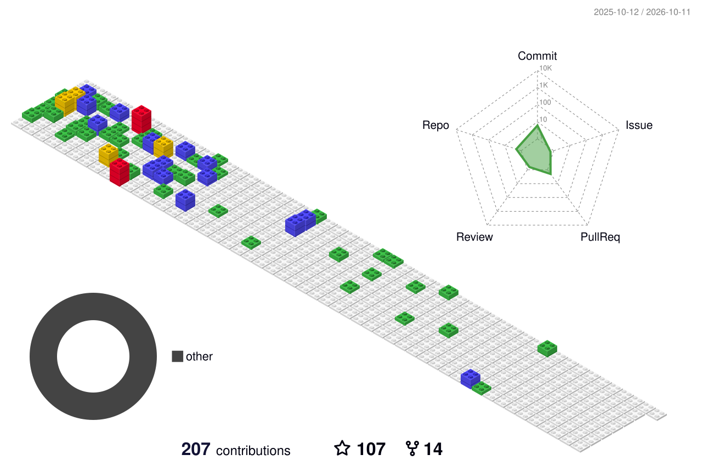

## Hi there 👋
<div align="center">
<span>  </span>
<span>        </span>
<span>  </span>
</div>
<div align="center">

<!--START_SECTION:waka-->

```txt
Python                     225 hrs 49 mins       █████████▓░░░░░░░░░░░░░░░   38.11 %
Markdown                   49 hrs 13 mins        ██░░░░░░░░░░░░░░░░░░░░░░░   08.31 %
Other                      42 hrs 42 mins        █▓░░░░░░░░░░░░░░░░░░░░░░░   07.21 %
JavaScript                 40 hrs 8 mins         █▓░░░░░░░░░░░░░░░░░░░░░░░   06.78 %
TypeScript                 37 hrs 24 mins        █▓░░░░░░░░░░░░░░░░░░░░░░░   06.31 %
```

<!--END_SECTION:waka-->
</div>


